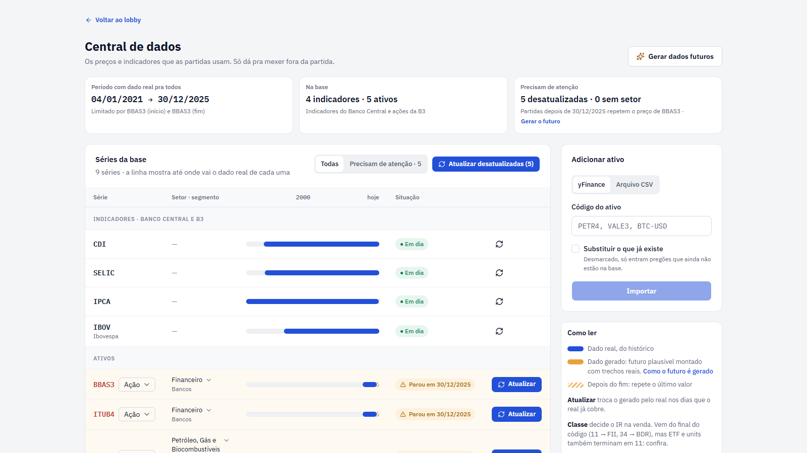

# Importação de Ativos

O simulador permite importar dados históricos de ativos para usar na simulação. Esta funcionalidade é essencial para ter acesso a ações, FIIs e ETFs com dados reais de mercado.

## Como Funciona

O sistema de importação carrega **dados históricos OHLCV** (Open, High, Low, Close, Volume) de ativos e os armazena no banco de dados para uso nas simulações.

**OHLCV significa:**
- **Open (Abertura)** - Preço na abertura do dia
- **High (Máxima)** - Preço mais alto do dia
- **Low (Mínima)** - Preço mais baixo do dia
- **Close (Fechamento)** - Preço no fechamento do dia
- **Volume** - Quantidade de ações negociadas no dia

Estes dados são usados para simular o movimento realista do mercado durante a simulação.



---

## Central de dados

A **Central de dados** é a tela onde você importa ações e acompanha quais séries estão guardadas no banco. Ela substitui a antiga tela "Importar Ativos" e é aberta pelo botão **Central de dados** no lobby.

Ela só pode ser aberta **fora de uma partida**: durante uma partida, o sistema leva você de volta para a tela principal.

A tela tem o resumo da base no topo e, abaixo dele, duas abas: **Indicadores**, com as séries do mercado e da economia, e **Ativos**, com as ações, FIIs, ETFs, BDRs e criptos importados. A aba **Ativos** traz ao lado o painel **Adicionar ativo** (explicado em [Métodos de importação](#métodos-de-importação)) e a legenda da barra. Cada aba mostra a quantidade de séries, e a aba **Ativos** avisa quantas pedem atenção.

Nas duas abas a barra de cada série usa a mesma régua de tempo, de 1980 até 20 anos depois de hoje, então dá para comparar quais séries cobrem mais anos. O trecho com dado real aparece em uma cor; a linha vertical marca hoje; e o que vem depois do último dado real depende da série:

- **Futuro gerado**: o trecho montado pelo gerador, em outra cor.
- **Listrado**: a série ainda não tem futuro gerado, e a partida repete o último valor dela (ver [Gerar dados futuros](#gerar-dados-futuros)).
- **Calculado na partida**: o PIB, o desemprego e a PTAX não recebem futuro gravado; a partida os calcula mês a mês a partir da SELIC, da inflação e da bolsa.
- **Sem nada depois**: as séries do Focus terminam na última pesquisa.

Passe o mouse sobre a barra para ver as datas e o que a partida faz depois do último dado.

### Aba Indicadores

A aba tem três grupos, cada um com a regra do que a partida faz depois do último dado: os indicadores econômicos (CDI, SELIC, IPCA e Ibovespa), a economia do país (crescimento do PIB, desemprego, a PTAX e o juro americano) e as expectativas do mercado (as quatro séries do Focus). O botão **Atualizar todas** baixa tudo de uma vez. Em cada linha:

- **Série**: o nome do indicador, com o código ao lado e uma frase curta dizendo o que ele é.
- **Dados reais**: a data do primeiro e a do último dado real.
- **Barra**: a linha do tempo descrita acima.
- **Situação**: **Em dia**, **Sem dado** (nunca foi baixada) ou **Atualizando…** enquanto a série é buscada na fonte.
- **Atualizar**: busca a série na fonte na hora.

O Focus é importado do Banco Central e não ganha futuro gerado: a barra termina na última pesquisa. Se a última pesquisa tem até 30 dias, a partida a usa; se é mais antiga, a partida usa a SELIC da história como o que o mercado espera. A economia do país tem uma exceção: o juro americano (Fed Funds) ganha futuro gerado.

### Aba Ativos

O filtro **Todas** / **Precisam de atenção** deixa só os ativos que pedem uma olhada (sem dado real, desatualizados ou sem setor). Em cada linha:

- **Ativo**: o código e o nome, com dois selos embaixo: a **classe** (Ação, FII, ETF, BDR ou Cripto) e a **origem** (**Nacional**, com a bandeira do Brasil, ou **Internacional**, com a dos Estados Unidos). Clicar num selo abre um menu, e a troca vale na hora. Na partida com governo, o ativo internacional anda só com o dólar da partida, e o nacional com a bolsa daqui (veja [Origem do ativo](#origem-do-ativo)).
- **Setor · segmento**: a classificação da ação (ver abaixo). Um ativo sem setor mostra o botão **Classificar**.
- **Dados reais**: as datas, a barra e, embaixo dela, o que acontece depois do último preço: **Depois: repete o último preço** ou **Futuro gerado até** a data.
- **Situação**: **Em dia**, **Parou em** com a data do último preço, **Sem dado**, **Sem setor** ou **Atualizando…**.
- **Atualizar** e **Apagar**, sempre à direita. O **Atualizar** ganha destaque quando o ativo parou. A lixeira remove o ativo da base com os preços, o perfil e a classificação, depois de uma confirmação, e é a saída para um ativo importado com dado errado. Um ativo negociado em alguma partida salva não pode ser apagado: a Central avisa em quantas partidas ele aparece, e é preciso excluir essas partidas no lobby antes. Depois de apagar, o futuro gerado passa a pedir recálculo.

Acima da lista ficam os botões **Corrigir erros de dado** e **Atualizar desatualizadas**.

### Origem do ativo

Todo ativo é **Nacional** ou **Internacional**. Na importação, o ativo cotado em dólar (`AAPL`, `BTC-USD`) ou da classe BDR nasce Internacional, e o resto nasce Nacional. O Yahoo Finance não separa um ETF de índice de fora (`IVVB11`, que replica o S&P 500) de um de índice daqui (`BOVA11`), então a Central deixa trocar: o selo de origem da linha abre um menu com a bandeira de cada lado, e a escolha vale na hora. Uma origem escolhida à mão não é trocada nas próximas atualizações do ativo.

Sem a expansão Governo, a origem não muda nada nos preços: eles são os da história. Com ela, o ativo internacional acompanha o dólar da partida (veja [A economia interligada](governo.md#a-economia-interligada)), e na listagem de **Renda variável** a bandeira aparece ao lado do código e um filtro separa os dois grupos.

### Setor e segmento das ações

Cada ação pertence a um **setor** (ex.: Financeiro) e, dentro dele, a um **segmento** (ex.: Bancos). A carteira mostra quanto da renda variável está em cada setor, e as estatísticas comparam os setores entre os jogadores.

- **Sugestão automática:** ao importar uma ação pelo Yahoo Finance (ou ao atualizar uma que ainda não tem classificação), o setor e a indústria que o Yahoo informa viram a sugestão. O setor chega traduzido para os nomes da B3 (ex.: *Financial Services* → Financeiro); o segmento chega como o Yahoo escreve (ex.: *Banks - Regional*).
- **Editar:** o botão **Classificar** (para uma ação ainda sem setor) ou o próprio setor e segmento da linha abre a edição ali mesmo. Escolha um setor e, se quiser, um segmento da lista, ou digite nomes novos, e use **Salvar**. **Tirar classificação** deixa a ação como "Sem setor", e **Cancelar** fecha sem mudar nada.
- Uma classificação feita à mão não é trocada pela sugestão nas próximas atualizações.

### Indicadores econômicos

- **CDI**: taxa de juros dos empréstimos entre bancos, publicada por dia. Serve de base para muitos CDBs. Ex.: um CDI de 0,0551% em um dia quer dizer que R$ 1.000 viram R$ 1.000,55 na noite.
- **SELIC**: taxa básica de juros da economia, definida pelo Banco Central e também publicada por dia.
- **IPCA**: inflação oficial, medida por mês. Ex.: um IPCA de 0,5% no mês significa que os preços subiram 0,5% naquele mês.
- **Ibovespa**: índice que acompanha o desempenho das ações mais negociadas da B3, a bolsa brasileira. Ex.: de 100.000 para 101.000 pontos é uma alta de 1%.

A economia do país aparece num grupo próprio:

- **PTAX**: a cotação oficial do dólar em reais, publicada pelo Banco Central por dia útil, desde 1º de julho de 1994 (o nascimento do real). Ex.: PTAX de 5,50 quer dizer que US$ 1 custa R$ 5,50. Ela converte para real o preço dos ativos cotados em dólar (veja [Yahoo Finance](#1-yahoo-finance-yfinance)) e é a história do dólar da partida. Depois do último dado real a partida a calcula mês a mês pela paridade do poder de compra: o dólar sobe pela diferença entre o IPCA da história e os 2,5% ao ano de inflação dos Estados Unidos. Ex.: com IPCA de 6%, o dólar sobe uns 3,5% ao ano, e R$ 5,00 viram R$ 5,17 em um ano. Como o crescimento do PIB e o desemprego, ela não tem futuro gerado.
- **Fed Funds**: o juro básico dos Estados Unidos, o que a [conta em dólar](./investimentos/renda-fixa.md#conta-em-dólar) rende, publicado por dia e guardado em % ao ano como o FRED o publica. Um valor por dia, desde 1º de julho de 1994, para cobrir o mesmo período da PTAX. Ex.: 5,25% quer dizer que US$ 1.000 rendem uns US$ 52,50 em um ano. Depois do último dado real a série ganha futuro gerado: volta para 3% ao ano, a projeção de longo prazo do Fed, perdendo metade da distância a cada 2 anos. Não limita o período da partida.
- **Crescimento do PIB**: quanto o país produziu a mais nos últimos 4 trimestres, contra os 4 trimestres anteriores, já descontada a inflação. Um valor por trimestre, desde o fim de 1997. Ex.: 2% quer dizer que a economia produziu 2% a mais do que no ano anterior; 2020 marca −3,3% (a pandemia) e 2021, +4,8%. Perto de 2% é o ritmo normal do Brasil; abaixo de zero é recessão.
- **Desemprego**: a parcela de quem procura trabalho e não acha, pela PNAD Contínua do IBGE. Um valor por mês, desde março de 2012. Ex.: 8% quer dizer que, de cada 100 pessoas que querem trabalhar, 8 estão sem vaga. Até uns 8% é um bom nível; acima de 12% é ruim.

Na partida, essas duas séries são a história do crescimento e do desemprego: a página **Economia** parte delas e soma o que o governo muda (veja [A economia interligada](./governo.md#a-economia-interligada)). Onde não há dado real (o PIB antes de 1997, o desemprego antes de 2012 e as duas depois do último dado), a partida segue o modelo do jogo, que anda com o juro real e a bolsa. Elas não limitam o período da partida, não entram no aviso de "dado acaba antes do fim" do lobby e não ganham futuro gerado.

**Expectativas do mercado (Focus).** O Focus é a pesquisa semanal em que o Banco Central pergunta a bancos e consultorias o que eles esperam da economia; cada série guarda a **mediana** (o valor do meio: metade das projeções passa dele e metade fica aquém, então um palpite fora da curva não a puxa), um valor por dia de pesquisa, em % como publicada:

- **Focus: SELIC da próxima reunião**, desde 18 de nov. de 2004. Ex.: 13,25% quer dizer que o mercado espera a SELIC a 13,25% ao ano depois da próxima reunião do Copom. É a base do **Mercado espera** do cartão [SELIC no Copom](./governo.md#a-selic-no-copom).
- **Focus: IPCA dos próximos 12 meses**, desde 7 de nov. de 2001. Ex.: 4,50% quer dizer que o mercado espera os preços 4,5% mais altos em um ano; perto da meta (3%) é tranquilo, e acima de 6% o mercado teme perder o controle da inflação.
- **Focus: PIB do ano**, desde 1999. Ex.: 2,00% é o crescimento que o mercado espera para o ano da pesquisa.
- **Focus: câmbio do fim do ano**, desde 2000. Ex.: 5,20 quer dizer R$ 5,20 por dólar esperados para dezembro do ano da pesquisa.

Cada linha da tabela mostra uma dica com isso. As quatro séries são só informação: não limitam o período da partida, não entram no aviso de "dado acaba antes do fim" do lobby e não ganham futuro gerado. Hoje só a SELIC esperada entra na conta da bolsa, pela surpresa do Copom.

**Fontes:** CDI, SELIC, IPCA e PTAX vêm do Banco Central, pelo sistema SGS (Sistema Gerenciador de Séries Temporais), nas séries 12 (CDI diário), 11 (SELIC diária), 433 (IPCA mensal) e 1 (PTAX, o dólar comercial de venda). O Ibovespa vem do Yahoo Finance (ticker `^BVSP`). O crescimento do PIB e o desemprego são do IBGE e chegam pelo mesmo SGS, que os republica: o PIB sai do índice do PIB real trimestral (série 22099, sem ajuste sazonal), somando os 4 últimos trimestres contra os 4 anteriores, e o desemprego é a taxa de desocupação da PNAD Contínua (série 24369). O Focus vem da API de expectativas do Banco Central (Olinda), com a mediana da pesquisa inteira. O Fed Funds vem do [FRED](https://fred.stlouisfed.org/series/DFF), a base de dados do banco central de St. Louis (série `DFF`, a taxa efetiva diária).

### Gerar dados futuros

Serve para continuar jogando depois do último dia com dado real. O futuro é montado com trechos reais da bolsa desde 2000 e fica gravado como dado gerado; as partidas o leem como leem o histórico. A explicação completa de como ele é montado está em [Como o futuro é gerado](./futuro-gerado.md).

O botão **Gerar dados futuros** (depois da primeira geração, **Gerar outro futuro**) abre um diálogo com os controles à esquerda e a prévia à direita.

**Controles:**

- **"Até quando"**: cada série continua do dia útil seguinte ao seu último dado real.
- **"Semente"**: um número que fixa o sorteio. A mesma semente com os mesmos controles gera sempre o mesmo futuro. "Sortear" escolhe outra semente, e outro futuro igualmente plausível.
- **"Temperatura"**, de 0 a 3, padrão 1. Mede o quanto o futuro se parece com as piores crises do histórico. Em 1, o futuro respeita o histórico como foi. Em 2, a maior queda do Ibovespa dentro de um ano (do topo até o fundo) passa de 30% em 64 de cada 100 anos; uma queda assim leva, por exemplo, de 100.000 para 65.000 pontos. Em 3, é crise permanente.
- **"Nível da inflação"**, de −5 a +20 pontos, padrão 0. Soma pontos permanentes à inflação de 12 meses, isto é, quanto os preços subiram nos últimos 12 meses: 4% quer dizer que algo que custava R$ 100 passou a custar R$ 104. Com +10, a inflação média fica em uns 16% ao ano e a SELIC em 24%.
- **"Frequência dos surtos"**, de 0 a 5 por década, padrão 0. Um surto é uma alta de inflação que passa em poucos anos. Com 1, em média um ano em dez abre um surto.
- **"Intensidade dos surtos"**, de 2 a 20 pontos, padrão 6. O pico médio de cada surto; fica desligada com 0 surtos.

**Prévia.** Gera o futuro sem gravar nada. Mostra o Ibovespa e um ativo à escolha, SELIC, inflação, crescimento do PIB e desemprego, além de quatro números. O PIB e o desemprego são calculados na hora a partir da SELIC, da inflação e da bolsa do futuro gerado, pela mesma conta da partida, sem os gastos do governo do jogo; só a prévia os mostra, e gravar não os grava:

- **Quanto o Ibovespa termina acima ou abaixo de hoje.** Ex.: de 100.000 para 120.000 pontos é uma alta de 20%.
- **A maior queda do pico ao fundo.** A maior queda do Ibovespa entre o ponto mais alto e o ponto mais baixo que vem depois dele. Ex.: sobe de 100.000 para 120.000 e depois cai para 90.000; a queda é de 25% (de 120.000 para 90.000).
- **A SELIC no pico.** A taxa mais alta que chega no futuro. Ex.: hoje ela está em 13,65% ao ano e no pico chega a 28%.
- **A inflação de 12 meses no pico.** A mais alta do futuro. Ex.: 14% quer dizer que, em 12 meses, os preços subiram 14%.

O botão "Gerar e gravar" grava o futuro de todas as séries. Gravar de novo pede a confirmação "Trocar e gravar" e substitui o futuro anterior: não há como apagar o futuro sem gerar outro. Cancelar no meio, ou um erro, não muda nada na base.

Depois de gravar, a Central mostra o card "Futuro gerado", com a semente e os controles usados. O botão "Gerar de novo" abre o diálogo com esses valores.

**Partidas salvas.** Quem já jogou dias do futuro gerado guarda a própria cópia deles antes de qualquer troca. Por isso, uma partida salva continua igual ao que foi jogado.

### Atualização

- **Atualizar** (em uma série) busca essa série na fonte na hora; **Atualizar todas**, na aba Indicadores, busca todos os indicadores.
- **Atualizar desatualizadas** atualiza as ações cujo último preço tem mais de 2 dias. O número entre parênteses diz quantas são.
- Uma ação com dados desatualizados aparece com o selo **Parou em** e o botão de atualizar em destaque.

Quando o dado real chega (pelo "Atualizar" de uma série ou pela atualização automática dos indicadores ao abrir o app), ele ocupa o lugar do gerado nos dias que cobre, e um aviso diz quantos pregões entraram. O gerado que sobra continua do ponto antigo, então pode haver um salto no dia da emenda. O card "Futuro gerado" passa a avisar até onde o real chegou e sugere "Gerar de novo" com os mesmos controles, o que emenda todas as séries a partir do real novo.

Ao iniciar, o app também busca os indicadores sozinho, no máximo uma vez a cada 6 horas. Sem internet, os dados já guardados continuam valendo e o app segue funcionando normalmente.

### Erros de dado do Yahoo Finance

Às vezes o Yahoo Finance traz um dia com preço absurdo: uma ação que cai 99% e, poucos pregões depois, volta ao preço de antes. Isso é erro da fonte, não mercado, mas na partida pareceria uma oportunidade de comprar a quase zero.

O simulador reconhece esse padrão quando o fechamento se afasta mais de 50% do último pregão bom e volta ao nível de antes em até 5 pregões. Nesses dias o fechamento vira uma **linha reta entre o último pregão bom e o primeiro que volta**, a abertura, a máxima e a mínima ficam iguais a ele e o volume zera, para o dia não desenhar uma vela falsa. Um salto que **não volta** (um desdobramento, por exemplo) não é tocado, e a cripto fica de fora, porque um pico real que some no dia seguinte é mercado.

O preço desses dias é inventado: a troca é essa. A linha da série mostra o selo **N dias corrigidos**, e passar o mouse sobre ele explica o que mudou.

- **Corrigir ao importar** (chave no topo da tabela): ligada por padrão, a importação já corrige os dias de erro. Desligada, o dado entra como o Yahoo Finance mandou. Vale para as próximas importações.
- **Corrigir erros de dado** (botão): aplica a correção ao que já está na base e mostra quantos dias foram trocados e em quantos ativos. Rodar de novo não acha mais nada. A correção sobrescreve o preço original, então, para voltar ao dado da fonte, é preciso desligar **Corrigir ao importar** e importar o ativo de novo com **Substituir o que já existe**.

### Preço bruto, desdobramentos e dividendos

A importação pelo Yahoo Finance guarda o **preço que o mercado negociou na época**, e não o preço "ajustado" que o Yahoo devolve por padrão. O Yahoo desfaz os desdobramentos no passado: depois de um desdobramento de 2 para 1, ele divide por dois todos os preços anteriores. A série fica contínua, mas mostra preços que nunca existiram. O simulador desfaz esse ajuste.

Os desdobramentos e os dividendos viram **eventos** da ação, cada um na sua **data ex** (o primeiro dia em que quem compra a ação já não tem direito ao provento). Na partida, o desdobramento muda a quantidade da posição e o dividendo cai no caixa (veja [Dividendos e desdobramentos](./investimentos/renda-variavel.md#dividendos-e-desdobramentos)).

- **Desdobramento**: a razão é de novos para antigos. Um 2 para 1 vale `2`: quem tinha 100 ações passa a ter 200, e o preço cai pela metade. Um agrupamento de 10 para 1 vale `0,1`: 100 ações viram 10, e o preço sobe dez vezes.
- **Dividendo**: o valor bruto pago por ação. Ex.: R$ 0,45 por ação, com 150 ações, são R$ 67,50 no caixa.

O CSV do Investing.com não traz eventos: o ativo importado por CSV tem só os preços, e o preço é o que o arquivo trouxer. Os ativos já importados antes desta versão precisam ser importados de novo, com **Substituir o que já existe**, para ganhar o preço bruto e os eventos.

---

## Métodos de Importação

### 1. Yahoo Finance (yfinance)

O simulador pode buscar dados diretamente do **Yahoo Finance** usando a biblioteca `yfinance`.

**Como importar:**

1. Acesse a **Central de dados** (botão no lobby)
2. No painel **Adicionar ativo**, deixe a fonte em **yFinance**
3. Informe o **Código do ativo** (ex: `PETR4`, `VALE3`, `BTC-USD`)
4. (Opcional) Marque **Substituir o que já existe**
5. Clique em **Importar**

**Exemplos de tickers brasileiros:**
- Ações: `VALE3`, `PETR4`, `BBAS3`, `ITUB4`
- FIIs: `XPML11`, `HGLG11`, `MXRF11`
- ETFs: `BOVA11` (Ibovespa), `SMAL11` (Small Caps)

O campo sugere os códigos da B3 enquanto você digita. O simulador guarda o código da B3 sem o sufixo `.SA` do Yahoo Finance e o acrescenta sozinho ao buscar; se você digitar `PETR4.SA`, ele vira `PETR4`. Cripto e ativos de outras bolsas (`BTC-USD`, `AAPL`) seguem o código do Yahoo Finance; uma criptomoeda entra com a classe **Cripto**, a única negociada em fração de unidade.

O ativo cotado em dólar (`AAPL`, `MSFT`, `BTC-USD`) entra na base já convertido para real: o preço e o dividendo de cada dia são multiplicados pela [PTAX](#indicadores-econômicos) daquele dia, e fim de semana e feriado usam a última PTAX publicada. Ex.: uma ação a US$ 200 num dia de PTAX 5,50 entra a R$ 1.100,00. Os pregões anteriores a julho de 1994 ficam de fora, porque a PTAX começa ali. Ativo cotado em outra moeda (`VOD.L`, em libras) é recusado, com o motivo. Ao atualizar um ativo que já estava na base em real, o histórico inteiro é refeito com a conversão.

:::warning Limitações do Yahoo Finance
A importação via Yahoo Finance depende da **API externa** deles, que pode ter:
- **Limitações de requisições** - Muitas requisições simultâneas podem ser bloqueadas
- **Indisponibilidade** - O serviço pode estar fora do ar temporariamente
- **Dados incompletos** - Alguns ativos podem não ter dados para todos os períodos
- **Atrasos** - Dados podem estar desatualizados (geralmente 1 dia de atraso)

Se você encontrar problemas, tente novamente mais tarde ou use a importação via CSV.
:::

---

### 2. Arquivo CSV Customizado

Você pode importar dados de qualquer fonte usando um **arquivo CSV** no formato aceito.

**Como importar:**

1. Prepare seu arquivo CSV no formato correto (veja abaixo)
2. Acesse a **Central de dados** (botão no lobby)
3. No painel **Adicionar ativo**, troque a fonte para **Arquivo CSV**
4. Arraste o arquivo para a área de upload ou escolha-o no computador. O limite é de 5 MB
5. Confira o **Código do ativo**: o painel o preenche com o nome do arquivo
6. (Opcional) Marque **Substituir o que já existe**
7. Clique em **Importar**

#### Formato do CSV

O arquivo segue o formato de exportação do **Investing.com** (histórico de preços, em CSV). As colunas **obrigatórias**, com estes nomes:

```csv
"Data","Último","Abertura","Máxima","Mínima","Vol."
"20.02.2026","25,00","24,88","25,48","24,86","30,94K"
"19.02.2026","25,00","24,78","25,30","24,62","23,22K"
"18.02.2026","24,74","24,79","25,00","24,30","26,93K"
```

**Especificações:**
- **Data** - Data no formato `dd.mm.aaaa` (ex: `20.02.2026`)
- **Último** - Preço de fechamento
- **Abertura** - Preço de abertura
- **Máxima** - Preço máximo
- **Mínima** - Preço mínimo
- **Vol.** - Volume negociado; aceita os sufixos `K` (mil) e `M` (milhão), como `30,94K`

**Regras:**
- ✅ Primeira linha deve ser o cabeçalho (nome das colunas)
- ✅ Valores numéricos usam `,` (vírgula) como separador decimal
- ✅ O arquivo precisa ser um CSV de até 5 MB. Outro tipo de arquivo é recusado com um aviso
- ⚠️ Valores ausentes viram zero e o servidor registra um aviso no log

**Exemplo de arquivo CSV válido:**

[📄 Baixe o arquivo de exemplo](/csv/exemplo-importacao-ohlcv.csv)


## Dicas Rápidas

- Use **Substituir o que já existe** quando quiser trocar os preços de um ticker que já está na base. Desmarcado, só entram os pregões que ainda não estão lá.
- A importação só pede confirmação quando vai substituir dados que já existem.
- Antes de escolher o período no lobby, confira na **Central de dados** até quando cada série tem dado real.
