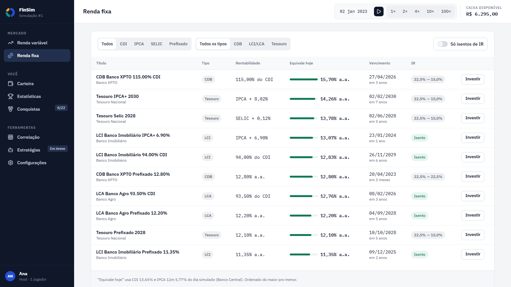
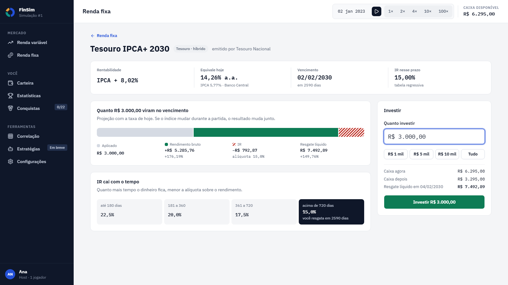

# Renda Fixa

Aprenda a investir em títulos de renda fixa no simulador.

## O que é Renda Fixa?

**Renda Fixa** são investimentos em que você empresta dinheiro e recebe de volta o valor inicial mais juros.
As **regras de remuneração são definidas no momento do investimento**, o que torna esse tipo de ativo mais previsível do que a renda variável.

**Características:**
- 💰 Regras de retorno conhecidas
- 📉 Menor volatilidade que renda variável
- 🛡️ Menor risco de mercado
- 📅 Prazos definidos ou estimáveis

## Tipos de Renda Fixa

No simulador, esses ativos seguem as mesmas **regras básicas de funcionamento e tributação** do mundo real, permitindo testar estratégias e entender os efeitos do tempo, da taxa e do Imposto de Renda.

---

### CDB (Certificado de Depósito Bancário)

**O que é:**
Um CDB é um título emitido por bancos para captar recursos. Ao investir, você está emprestando dinheiro ao banco, que se compromete a devolver o valor investido acrescido de juros.

**Características no mundo real:**

* Emitido por bancos comerciais
* Pode ser **prefixado**, **pós-fixado** (ex: % do CDI) ou híbrido
* Pode ter liquidez diária ou vencimento definido
* Conta com proteção do **FGC (Fundo Garantidor de Créditos)** até R$ 250.000 por CPF e por instituição financeira, respeitando o limite global do FGC.
* **Tributação:** Imposto de Renda regressivo sobre os rendimentos

**No simulador:**

* Você pode investir em CDBs de diferentes bancos
* A rentabilidade varia conforme o banco e o prazo
* O IR é aplicado automaticamente conforme o tempo de permanência

---

### LCI (Letra de Crédito Imobiliário)

**O que é:**
A LCI é um título emitido por bancos para financiar o setor imobiliário. Os recursos captados são direcionados para empréstimos e financiamentos imobiliários.

**Características no mundo real:**

* Lastreada em operações do setor imobiliário
* **Isenta de Imposto de Renda para pessoa física**
* Geralmente possui **prazo mínimo de carência** (não pode ser resgatada antes)
* Protegida pelo **FGC até R$ 250.000**

**No simulador:**

* Apresenta rentabilidade nominal menor que CDBs equivalentes
* Pode gerar **retorno líquido competitivo** por conta da isenção de IR
* Ideal para simular estratégias focadas em eficiência tributária

---

### LCA (Letra de Crédito do Agronegócio)

**O que é:**
A LCA funciona de forma semelhante à LCI, mas os recursos captados são destinados ao financiamento do agronegócio.

**Características no mundo real:**

* Lastreada em operações do setor agrícola
* **Isenta de Imposto de Renda para pessoa física**
* Normalmente possui prazo mínimo de carência
* Protegida pelo **FGC até R$ 250.000**

**No simulador:**

* Comportamento similar ao da LCI
* Permite comparar estratégias entre ativos tributados e isentos
* Útil para observar o impacto do IR no longo prazo

---

### Tesouro Direto

**O que é:**
São títulos públicos emitidos pelo **Governo Federal** para financiar a dívida pública. Ao investir, você empresta dinheiro ao governo.

**Características no mundo real:**

* Considerados os investimentos de **menor risco de crédito** no Brasil
* Possuem liquidez diária, mas o valor de venda pode variar antes do vencimento devido à marcação a mercado.
* **Tributação:** Imposto de Renda regressivo sobre os rendimentos
* Podem sofrer marcação a mercado

**Principais tipos:**

* **Tesouro Selic:** acompanha a taxa Selic (baixo risco de oscilação)
* **Tesouro Prefixado:** taxa fixa definida na compra
* **Tesouro IPCA+:** inflação (IPCA) + taxa fixa, protegendo o poder de compra

**No simulador:**

* Os títulos do governo têm tela própria, **Tesouro**, no menu Mercado: seis títulos sempre à venda (um Selic, dois Prefixados e três IPCA+), com a taxa revista a cada fechamento de mês
* Com a expansão Governo & Política, a taxa de todos soma o **prêmio de risco** do país, que sobe quando a dívida do governo cresce; a tela mostra a taxa em duas partes (base + prêmio) e o termômetro do risco
* Quem compra trava a taxa do dia. Dá para vender em qualquer dia, inteiro ou em parte, pelo preço de hoje (**marcação a mercado**): se a taxa subiu desde a compra, o Prefixado e o IPCA+ valem menos que a curva; se caiu, valem mais. O Tesouro Selic vale o que acumulou
* Na compra e na venda, os botões **25%**, **50%** e **Tudo** preenchem o valor com essa fração do caixa (compra) ou da posição (venda)
* O IR é regressivo sobre o ganho; com perda, não há IR
* Quando o caixa não cobre uma despesa, o imposto ou a parcela do empréstimo, o simulador vende sozinho a liquidez diária e o Tesouro Selic antes de usar o cheque especial. Uma chave na tela do Tesouro estende isso ao Prefixado e ao IPCA+, a preço de mercado, o que pode realizar perda

---

## Tributação – Imposto de Renda

No Brasil, a maioria dos investimentos de renda fixa é tributada pelo **Imposto de Renda regressivo**, onde a alíquota diminui conforme o tempo que o dinheiro permanece investido.

### Tabela de IR Regressivo

| Prazo do investimento | Alíquota |
| --------------------- | -------- |
| Até 180 dias          | 22,5%    |
| 181 a 360 dias        | 20%      |
| 361 a 720 dias        | 17,5%    |
| Acima de 720 dias     | 15%      |

* O imposto incide **somente sobre os rendimentos**, não sobre o valor total investido.
* **LCI e LCA são isentas de IR** para pessoa física, o que pode torná-las mais vantajosas mesmo com taxas menores.

---

## Prefixado vs Pós-fixado

### Prefixado

**O que é:** A taxa de retorno é definida no momento da contratação.

**Exemplo:** CDB prefixado de 10% ao ano
- Se você investir R$ 10.000, sabe que terá R$ 11.000 ao final de 1 ano (antes de IR e considerando que o investimento seja mantido até o vencimento)

**Vantagens:**
- ✅ Previsibilidade total
- ✅ Ideal quando você acredita que os juros vão cair

**Desvantagens:**
- ⚠️ Se os juros subirem, você perde rentabilidade relativa
- ⚠️ Pode ter perda em resgate antecipado (marcação a mercado)

---

### Pós-fixado

**O que é:** A taxa de retorno acompanha um índice (CDI nos CDBs, LCIs e LCAs; Selic no Tesouro Selic).

**Exemplo:** CDB pós-fixado de 100% do CDI
- Se o CDI estiver em 10% ao ano, você ganha 10% ao ano
- Se o CDI subir para 12%, você passa a ganhar 12%

**Vantagens:**
- ✅ Acompanha variações da economia
- ✅ Proteção contra alta de juros

**Desvantagens:**
- ⚠️ Não sabe exatamente quanto vai ganhar
- ⚠️ Se juros caírem, rentabilidade diminui

---

### Inflação (IPCA+)

**O que é:** Rentabilidade = Inflação (IPCA) + taxa prefixada.

**Exemplo:** Tesouro IPCA+ 2030 com taxa de IPCA + 5% ao ano
- Se a inflação for 4%, você ganha 9% (4% + 5%)
- Se a inflação for 6%, você ganha 11% (6% + 5%)

**Vantagens:**
- ✅ Protege seu poder de compra
- ✅ Ideal para longo prazo

**Desvantagens:**
- ⚠️ Rentabilidade pode ser baixa se a inflação estiver baixa
- ⚠️ Pode ter perda em resgate antecipado (marcação a mercado)

---

## Como o rendimento é calculado

No simulador, CDI, SELIC e IPCA são as **taxas reais publicadas pelo Banco Central**, e não números fixos. Cada título rende com a taxa do dia (ou do mês) em que o dinheiro estava aplicado.

### CDI e SELIC (taxa por dia)

Essas taxas são publicadas **por dia**, em % ao dia. Ex.: uma taxa de 0,0551% em um dia faz R$ 1.000 virarem R$ 1.000,55 na noite.

- Um título de **110% do CDI** rende 1,1 vez a taxa do dia. Ex.: 1,1 × 0,0551% = 0,06061% naquele dia.
- A taxa de um dia útil vale para a noite até o próximo dia útil. O fim de semana não conta: a taxa da sexta-feira rende uma única vez, de sexta para segunda.
- Em **feriados** (dias em que o Banco Central não publica CDI nem SELIC), o título não rende nada.

### IPCA (taxa por mês)

O IPCA é publicado **por mês**, em % ao mês. O simulador espalha a inflação de cada mês pelos dias úteis daquele mês, de forma que o mês inteiro soma exatamente a inflação publicada. Ex.: se o IPCA do mês é 0,5%, um título atrelado ao IPCA rende 0,5% no mês inteiro.

Títulos **IPCA+** somam uma parte fixa (o *spread*, combinado na compra) por cima do índice. Ex.: IPCA + 5% a.a. (a.a. quer dizer "ao ano") rende a inflação do período mais 5% ao ano, proporcionalmente ao tempo.

### Depois do último dado real

Depois do último dia com dado real, o simulador repete o último valor conhecido. É a mesma regra usada para os preços das ações.

### Projeção na compra

Ao comprar, a projeção mostrada assume que o indexador (CDI, SELIC ou IPCA) continua no valor que se conhece no dia da compra. Como essas taxas mudam com o tempo, o resultado real pode ser diferente.

### Exemplo conferido

Um CDB de 100% do CDI comprado em 02/01/2020 e resgatado em 31/12/2020 rende **2,750141%** antes do IR. Ou seja, R$ 1.000 viram R$ 1.027,50 antes do imposto. Esse é exatamente o resultado da "Calculadora do Cidadão", do Banco Central, para o mesmo período.

---

## Como Funciona no Simulador

### Investir em Renda Fixa

1. Acesse **Renda fixa** para ver a lista de títulos disponíveis.
2. Na linha do título, clique em **Investir** para abrir os detalhes.
3. Em **Quanto investir**, informe o valor. Os atalhos **R$ 1 mil**, **R$ 5 mil** e **R$ 10 mil** preenchem o campo, e um botão de máximo usa todo o seu caixa.
4. Confira o **Resgate líquido** na data de vencimento e clique em **Investir R$ valor**.

### Simulação e detalhes do investimento

Na tela de detalhes do ativo, você acompanha:
- O caminho do dinheiro: o valor aplicado, o rendimento, o imposto (IR) e o valor de resgate projetado.
- **Rentabilidade**, **Vencimento**, **IR nesse prazo** e **Equivale hoje** (a taxa por ano, já combinada com CDI e IPCA do dia).
- O card **IR cai com o tempo**, com a tabela regressiva para entender a projeção até o vencimento.

### Liquidez diária: resgatar a qualquer dia

Os títulos com a etiqueta **liquidez diária** podem ser resgatados em qualquer pregão, pelo valor corrigido até o dia, sem esperar o vencimento. O dinheiro volta ao caixa no mesmo pregão.

1. Abra o título e vá na aba **Resgatar** (ou clique em **Resgatar** na linha da Carteira).
2. Informe quanto quer **receber no caixa**. Os atalhos **R$ 1 mil**, **R$ 5 mil**, **Metade** e **Tudo** preenchem o campo.
3. Confira a conta: quanto sai do título, o rendimento dessa parte, o IR e, nos primeiros 30 dias, o IOF. Depois clique em **Receber R$ valor no caixa**.

- **IOF:** imposto que cobra de quem resgata antes de 30 dias. Incide sobre o rendimento e começa em 96% no 1º dia, caindo até 3% no 29º; a partir do 30º dia é zero. Ex.: um título que rendeu R$ 10 e é resgatado no 1º dia perde R$ 9,60 de IOF.
- **IR:** a mesma tabela regressiva, contada desde a primeira aplicação, sobre o rendimento que sobrou depois do IOF.
- **Oferta rara:** de vez em quando o catálogo do mês traz um título de liquidez diária acima de 100% do CDI, com **teto por jogador** (o quanto cada um pode aplicar ao todo). Quando o mês vira ela sai do catálogo: não dá mais para aplicar, mas quem já tem segue resgatando.
- **CDB sempre disponível:** um CDB de 100% do CDI com liquidez diária fica aberto a partida inteira, como a reserva que rende.

A **reserva de emergência** da Meta soma o caixa e a liquidez diária: os dois saem no mesmo dia. Quando o caixa não cobre uma despesa, o simulador resgata sozinho a liquidez diária e o Tesouro Selic antes de recorrer ao cheque especial.

### Acompanhar investimentos

1. Acesse **Carteira**.
2. Veja seus investimentos em **Renda Fixa** na tabela da carteira.
3. Clique na linha do título para voltar à tela dele.

:::warning Atenção ao IR
O simulador calcula automaticamente e desconta o Imposto de Renda sobre o resgate, seguindo a tabela regressiva.
:::

---

## Conta em dólar

A **Conta em dólar** fica ao lado do CDB sempre disponível, no topo da **Renda fixa**. O seu dinheiro vira dólar ao câmbio do dia, rende o **juro americano** (Fed Funds, a taxa básica dos Estados Unidos) todo dia útil e volta ao caixa em qualquer pregão. É a forma de ter dólar na carteira e de se proteger de uma crise, em que o dólar costuma subir.

- **Saldo e valor em reais:** o saldo é em US$ e só cresce com o juro. O valor em reais é o saldo vezes o dólar de hoje: `valor em reais = saldo em US$ × dólar do dia`. Com US$ 2.000 e o dólar a R$ 5,00, a conta vale R$ 10.000; com o dólar a R$ 5,50, vale R$ 11.000, sem o saldo mudar.
- **IOF de câmbio na entrada:** 1,1% do valor aplicado, descontado antes de comprar os dólares. Ex.: R$ 10.000 a R$ 5,00 pagam R$ 110 de IOF e compram US$ 1.978,00. No resgate não há IOF.
- **IR de 15% no resgate:** incide sobre o **ganho em reais**, que junta o juro do Fed e a variação do dólar, e é retido na hora. Se o valor em reais está abaixo do que você aplicou, não há IR: perda não paga imposto. A alíquota é fixa e não muda com a medida do governo.
- **Liquidez diária:** o resgate leva o valor do dia, parcial ou total. Se o caixa não cobre uma despesa, o resgate automático da reserva também vende a conta em dólar.
- **Sem empréstimo em dólar:** a conta não serve de garantia nem se empresta em dólar.

**O que decide se vale a pena** é o dólar contra a diferença entre o CDI e o juro americano. O cartão da conta mostra o **empate**: quanto o dólar precisa subir em 12 meses para a conta render o mesmo que o CDI, a conta `(1 + CDI) ÷ (1 + juro do Fed) − 1`. Ex.: com CDI de 13% e Fed de 5%, o empate é 7,6%. R$ 10.000 aplicados a R$ 5,00 viram US$ 1.978,00; em um ano, com o Fed a 5%, são US$ 2.076,90. Com o dólar a R$ 5,50 (alta de 10%), valem R$ 11.422,95, contra os R$ 11.300 de um CDB de 100% do CDI, antes do IR. Com o dólar a R$ 5,20, valem R$ 10.799,88 e o CDI ganha. O IOF de 1,1% soma mais uns 1,1 ponto ao empate, e o IR de 15% corta o ganho dos dois lados.

**O juro americano na partida.** A história é a série do Fed publicada pelo FRED (veja [Importação de ativos](../importacao-ativos.md#indicadores-econômicos)). Depois do último dado real, o juro volta para **3% ao ano**, a projeção de longo prazo do próprio Fed, perdendo metade da distância a cada 2 anos: com o Fed a 5%, ele passa a uns 4% em 2 anos e a uns 3,5% em 4. O juro americano não depende do governo da partida (veja [Governo](../governo.md)).

---

## Estratégias Comuns

### Reserva de Emergência
Use Tesouro Selic ou CDBs com liquidez diária para ter dinheiro acessível rapidamente.

### Objetivo de Médio/Longo Prazo
Use prefixados ou IPCA+ para objetivos futuros (casa, aposentadoria).

### Diversificação
Combine renda fixa e variável para equilibrar risco e retorno do portfólio.

---

## Próximos Passos

- [Renda Variável](./renda-variavel) - Investimentos de maior risco/retorno
- [Carteira](../carteira) - Acompanhe todo seu portfólio
