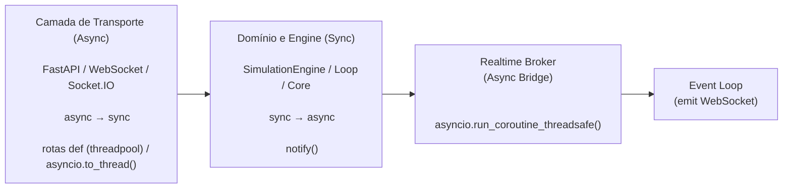

# Diretrizes Async vs Sync

Este projeto adota **deliberadamente** um modelo híbrido (**sync + async**).

A arquitetura é construída de forma que:
- o **core da simulação e do domínio seja estritamente síncrono**
- o **código assíncrono fique restrito à camada de transporte** (ASGI, WebSocket, Socket.IO)

Este documento define as **regras oficiais** para essa separação, evitando o vazamento de `async/await` para o domínio e garantindo integração segura com o event loop.

:::note Decisão Arquitetural (ADR)
Este documento registra uma **decisão arquitetural explícita** do projeto.

Alterar o modelo sync/async descrito aqui **impacta diretamente o determinismo, o controle de estado e o modelo de execução da simulação** e **não deve ser feito sem reavaliar toda a arquitetura e seus trade-offs**.
:::

## Filosofia do Projeto

O objetivo é **conter o código assíncrono na camada de transporte** e impedir que conceitos como `await`, `asyncio` ou event loop contaminem o domínio.

:::info Princípio Chave
**O domínio não conhece `asyncio`, event loop ou `await`.**  
Async é um detalhe de infraestrutura, não de regra de negócio.
:::

---

## Convenções por Camada

### Domínio e Engine (Síncrono)

A lógica central da simulação — `backend/features/simulation/*`, `SimulationEngine`, os brokers de renda variável e renda fixa, `UserManager` e os repositórios — **permanece intencionalmente síncrona** (`def`).

**Motivos:**
- Executa regras de negócio e cálculos determinísticos
- Possui estado mutável controlado
- Não depende de I/O assíncrono
- É mais simples de testar, depurar e raciocinar
- Pode rodar de forma previsível em uma thread dedicada

**Exemplo:**
```python
class SimulationEngine:
    def get_portfolio(self, client_id: UUID) -> PortfolioDTO:
        with self._lock:
            equity = [
                pos.to_dto(self.get_current_price(pos))
                for pos in self.broker.get_positions(client_id).values()
                if pos.size > 0
            ]
            cash = self._cash[client_id]
        ...
````

---

### Loop da Simulação (Thread Dedicada)

O loop de simulação roda em **uma thread própria**, separada do event loop assíncrono da aplicação.

Essa decisão **não é uma preferência estilística**, mas uma consequência direta do modelo de execução da simulação.

A simulação é um processo contínuo que possui:

* um `while` controlando explicitamente o ciclo de vida
* execução sequencial de `next_tick()`
* controle manual de tempo (`sleep`)
* sincronização explícita de estado (`lock`)
* necessidade de previsibilidade e determinismo

Esse tipo de execução **é inerentemente síncrono**.

Uma thread Python executa código de forma **sequencial e bloqueante**.
Portanto, o código que roda dentro dela **deve ser síncrono** para manter simplicidade e previsibilidade.

Tornar esse loop assíncrono exigiria:

* transformar `next_tick()` em `async`
* propagar `async/await` por todo o core
* trocar `threading.Lock` por `asyncio.Lock`
* introduzir conversões constantes entre sync ↔ async

Tudo isso **aumentaria a complexidade**, sem trazer ganhos reais para esse tipo de simulação.

---

#### Estrutura do Loop

```python
class SimulationLoopController:
    def __init__(self):
        self._thread: threading.Thread | None = None
        self._stop_event = threading.Event()
        self._pause_event = threading.Event()
        self._lock = threading.Lock()

    def _run(self):
        """Executa em thread dedicada"""
        simulation = SimulationManager.get_active_simulation()
        while not self._stop_event.is_set():
            speed = simulation.get_speed()
            if speed <= 0:
                self._pause_event.wait()  # pausado: espera retomar ou parar
                continue
            simulation.next_tick()  # Código síncrono
            time.sleep(1 / speed)
```

Esse modelo oferece:

* execução previsível e determinística do `tick`
* isolamento total do core em relação ao event loop async
* uso direto de primitivas de sincronização (`threading.Lock`, `threading.Event`)
* controle explícito de tempo sem dependência de `asyncio`
* menor custo cognitivo e arquitetural

---

#### Inicialização da Thread

```python
self._thread = threading.Thread(
    target=self._run,
    daemon=True,
    name="simulation-loop",
)
self._thread.start()
```

---

### Camada de Transporte (Async)

FastAPI, ASGI, WebSocket e Socket.IO **são assíncronos por definição**.

Nessa camada, o uso de `async` **é obrigatório onde há I/O assíncrono**, mas **não deve vazar para o core**.

As rotas REST que chamam o domínio são `def` comuns: o FastAPI roda cada uma numa thread do próprio pool, então o event loop não trava e o domínio segue síncrono, sem `await` nenhum.

**Exemplo:**

```python
@portfolio_router.get("", response_model=PortfolioDTO)
def get_portfolio(client_id: ClientID, simulation: ActiveSimulation):
    return simulation.get_portfolio(client_id)  # método síncrono
```

`async def` fica para o que é assíncrono de verdade: os handlers do Socket.IO (`connect`, `subscribe`, `presence`), o início e a parada do link de convite e o serviço dos arquivos do frontend.

---

## Pontes entre Sync e Async (Regra de Ouro)

### Async → Sync (event loop chamando código bloqueante)

✔ **Endpoint REST: escreva `def`, e o FastAPI roda na threadpool**

```python
@router.get("/portfolio")
def get_portfolio(client_id: ClientID, simulation: ActiveSimulation):
    return simulation.get_portfolio(client_id)
```

✔ **Dentro de um `async def`: use `asyncio.to_thread()`**

```python
result = await asyncio.to_thread(sync_function, arg1, arg2)
```

**Quando usar o `to_thread`:**

* Handler WebSocket (`async def`) que precisa chamar algo bloqueante do domínio
* Qualquer código async chamando algo bloqueante

---

### Sync → Async (thread chamando coroutine)

✔ **Use `asyncio.run_coroutine_threadsafe()`**

```python
asyncio.run_coroutine_threadsafe(coro(), loop)
```

**Quando usar:**

* Loop de simulação notificando WebSocket
* Core disparando eventos realtime
* Código síncrono que precisa interagir com async

O broker é o único que faz essa ponte: o resto do core só chama `notify()`.

---

## `notify()` — Fire and Forget (Padrão Oficial)

O broker realtime expõe um método **síncrono**, propositalmente:

```python
def notify(event, payload, to=None) -> None
```

**Por quê?**

* O core é síncrono
* O core não deve depender de `await`
* Notificação é efeito colateral, não fluxo principal

---

### Implementação Correta do Broker

A responsabilidade de fazer a ponte **sync → async** é **exclusivamente do broker**.

```python
class SocketBroker:
    def notify(
        self,
        event: Event,
        payload: JSONValue,
        to: ClientID | None = None,
    ) -> None:
        with self._lock:
            targets = set(self._subscriptions.get(event, set()))
            if to is not None:
                targets &= self._client_to_sids.get(to, set())

        if self._loop is None:
            raise RuntimeError("Event loop não está vinculado ao SocketBroker")

        for sid in targets:
            asyncio.run_coroutine_threadsafe(
                self.sio.emit(event, payload, to=sid),
                self._loop,
            )
```

O event loop é ligado ao broker na subida do servidor (`bind_event_loop`). A assinatura de cada aba (`subscribe`) decide quem recebe cada evento.

---

### Exemplo Real (Core Síncrono)

```python
# No fim da partida, o loop (thread síncrona) avisa os jogadores
notify(
    "simulation_ended",
    SimulationEndedEventDTO(
        reason="completed", simulation_id=simulation.settings.id
    ).to_json(),
)
```

---

## Diagrama Final de Arquitetura


