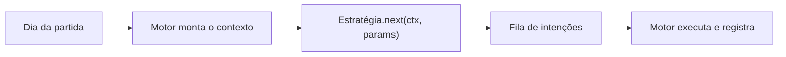

# Escrevendo uma estratégia

Como acrescentar ao app uma estratégia de investimento própria: a classe base, o que ela recebe a cada dia, como declarar nome e parâmetros e onde registrá-la. Quem prefere não mexer no código do app pode jogar como um bot, escrito em qualquer linguagem, pelas rotas HTTP e pelo Socket.IO que a própria interface usa: veja [Bot pela API](../como-usar/bot-pela-api.md).

---

## Visão geral

Uma estratégia é uma **classe sem estado**: a cada dia da partida o motor cria uma instância nova, entrega o **contexto** do jogador (caixa, posições, cotações, histórico) e a estratégia responde enfileirando **intenções** de compra, venda ou aplicação. Depois que `next` termina, o motor executa as intenções em nome do jogador, pelas mesmas chamadas que a interface faz.

O modo automático, os bots do lobby e o backtest usam exatamente esta interface. Uma estratégia escrita uma vez aparece nos três.



---

## Anatomia da classe

Toda estratégia herda de `BaseStrategy` ([base_strategy.py](https://github.com/LiloMarino/SimuladorFinanceiro/blob/main/backend/features/strategy/base_strategy.py)) e declara seus dados como atributos de classe:

| Atributo | O que é |
| --- | --- |
| `key` | Identificador estável, em inglês (`moving_average_cross`). É o que fica gravado na partida salva; trocá-lo desliga a estratégia de quem já a usava. |
| `name` | Nome mostrado na página de Estratégias. |
| `summary` | Uma frase para a lista. |
| `description` | Explicação da regra para o detalhe da estratégia. |
| `group` | `StrategyGroup.REFERENCE` (régua para comparar, como "comprar e segurar") ou `StrategyGroup.TACTIC` (regra que tenta ganhar do mercado). |
| `params` | Tupla de `ParamSpec`: os parâmetros que o jogador ajusta na tela. |
| `view_kind` | O bloco do detalhe: `SIGNAL` (gráfico de um ativo), `RANKING`, `ALLOCATION` ou `NONE`. |
| `term_hint` | Explicação, em português claro e com um exemplo numérico, do termo técnico que a regra usa. |
| `bot_names` | Nomes sugeridos para um bot que joga esta estratégia. |

### Parâmetros

Cada parâmetro é um `ParamSpec` com `key`, `label`, `kind`, `hint` (a dica da tela), `default`, `min`, `max` e `unit`. O `kind` define o campo da tela:

| `StrategyParamKind` | Valor | Exemplo |
| --- | --- | --- |
| `INT` | Número inteiro dentro de `min` e `max` | Média curta: 50 dias |
| `PERCENT` | Inteiro dentro de `min` e `max`, mostrado com `%` | Parte do caixa por compra: 20% |
| `TICKER` | Uma ação da partida | Ativo que recebe o caixa |
| `TICKERS` | Lista de ações (até 30) | Ações que a estratégia opera |

`TICKER` e `TICKERS` não têm padrão fixo: o catálogo ([catalog.py](https://github.com/LiloMarino/SimuladorFinanceiro/blob/main/backend/features/strategy/catalog.py)) calcula o padrão para a partida ao ligar. Em `TICKERS` são as 10 ações de maior volume financeiro dos últimos 60 pregões; em `TICKER`, o `default` é o ativo preferido e cede à ação mais negociada quando a partida não o tem.

### Métodos

| Método | Para que serve |
| --- | --- |
| `validate(params, known_tickers)` | Devolve os erros por campo, em português; vazio quando os parâmetros valem. A versão da base confere tipo e faixa de cada `ParamSpec`. |
| `needed_days(params)` | Quantos pregões de histórico a estratégia pede para ter sinal. |
| `next(ctx, params)` | Decide o dia: lê o contexto e enfileira intenções. É onde a estratégia opera. |
| `signal(history, params)` | Desenha, para um ativo, as linhas e os marcadores de compra e venda do gráfico do detalhe. Nulo quando o histórico não basta. |
| `view(ctx, params)` | Monta o ranking ou a alocação do jogador hoje (para `RANKING` e `ALLOCATION`). |

Para ler os parâmetros dentro de `next`, use `param_int`, `param_ticker` e `param_tickers`: elas devolvem o valor já com o tipo certo.

---

## O contexto do dia

`next` recebe um `StrategyContext` ([context.py](https://github.com/LiloMarino/SimuladorFinanceiro/blob/main/backend/features/strategy/context.py)): um retrato do dia em dados simples, montado da memória do motor, sem acesso ao banco.

| Campo | O que traz |
| --- | --- |
| `date` | O dia da partida. |
| `cash` | Caixa disponível. Saldo negativo (cheque especial) conta como zero. |
| `holdings` | Posições em ações por ticker: `size`, `reserved` (parte presa em ordens abertas) e `avg_price`. |
| `fixed_holdings` | Títulos de renda fixa do jogador, com o valor atual e, quando há liquidez diária, o líquido que o resgate de hoje mandaria ao caixa. |
| `fixed_offers` | Ofertas de renda fixa do dia, com a taxa real. |
| `quotes` | Cotação do dia por ticker: fechamento, volume, setor e segmento. |
| `indicators` | CDI, Selic e IPCA do dia, como taxa anual (`0.149` é 14,9% ao ano). |
| `open_orders` | Ordens abertas do jogador. |
| `history(ticker, days)` | Os últimos `days` pregões do ativo até hoje, em OHLCV (abertura, máxima, mínima, fechamento e volume), do mais antigo ao mais novo, como `DataFrame` do pandas. |

As ações enfileiram intenções, e o segundo argumento é sempre o `reason`, a frase em português que aparece na coluna "Por quê" do registro da estratégia:

| Chamada | Intenção |
| --- | --- |
| `ctx.buy(ticker, quantity, reason, limit=None)` | Compra. Sem `limit`, a ordem é a mercado. |
| `ctx.sell(ticker, quantity, reason, limit=None)` | Venda. |
| `ctx.cancel(order_id, reason)` | Cancela uma ordem aberta. |
| `ctx.invest(asset_uuid, value, reason)` | Aplica `value` em uma oferta de renda fixa. |
| `ctx.redeem(asset_uuid, value, reason)` | Resgata de um título com liquidez diária; `value` é o líquido que a estratégia quer no caixa. |

As intenções só são executadas depois que `next` termina, então `ctx.cash` e `ctx.holdings` não mudam durante a chamada. Uma estratégia que compra mais de um ativo no mesmo dia desconta ela mesma do caixa que calculou. O mercado ou o caixa pode recusar uma intenção (falta de saldo ou de liquidez, por exemplo): ela vira uma linha "Recusada" no registro, com o motivo, e as demais seguem.

---

## Exemplo comentado: cruzamento de médias

A estratégia "Cruzamento de médias 50/200" ([moving_average.py](https://github.com/LiloMarino/SimuladorFinanceiro/blob/main/backend/features/strategy/moving_average.py)) usa quase tudo o que a base oferece, por isso serve de modelo. A ideia: a **média móvel** é o preço médio dos últimos N pregões. Com o fechamento em R$ 32 e a média de 50 dias em R$ 31, o preço está acima da tendência recente. Quando a média **curta** (50 dias) passa por cima da **longa** (200 dias), a alta recente ficou mais forte que a tendência de fundo: sinal de compra. Quando passa por baixo, sinal de venda.

### Declaração

```python
class MovingAverageCross(BaseStrategy):
    key = "moving_average_cross"          # identificador gravado na partida
    name = "Cruzamento de médias 50/200"  # nome na página de Estratégias
    bot_names = ("O Grafista", "Cruza-Média", "Linha do Tempo")
    summary = "Compra quando a média curta passa a longa."
    description = (
        "Compra quando a média curta passa a longa para cima; vende tudo daquele "
        "ativo quando cruza para baixo."
    )
    group = StrategyGroup.TACTIC          # tenta ganhar do mercado
    view_kind = StrategyView.SIGNAL       # o detalhe mostra o gráfico do sinal
    term_hint = (
        "Média móvel é o preço médio dos últimos N pregões. Ex.: a média de 50 dias a "
        "R$ 32 cruzando para cima a de 200 dias a R$ 31 mostra que a alta recente "
        "ficou mais forte que a tendência longa: sinal de compra."
    )
```

### Parâmetros

```python
    params = (
        ParamSpec(
            key="short_window",
            label="Média curta",
            kind=StrategyParamKind.INT,
            default=50, min=5, max=100, unit="dias",
            hint="Média dos preços de fechamento dos últimos dias. ...",
        ),
        ParamSpec(
            key="long_window",
            label="Média longa",
            kind=StrategyParamKind.INT,
            default=200, min=50, max=400, unit="dias",
            hint="Média de mais dias, que mostra a tendência de fundo. ...",
        ),
        ParamSpec(
            key="cash_pct",
            label="Quanto do caixa por compra",
            kind=StrategyParamKind.PERCENT,
            default=20, min=5, max=100, unit="%",
            hint="Parte do caixa disponível que cada compra usa. ...",
        ),
        ParamSpec(
            key="tickers",
            label="Ações que ela opera",
            kind=StrategyParamKind.TICKERS,   # sem default: o catálogo calcula
            hint="A estratégia só compra e vende estas ações. ...",
        ),
    )
```

Os quatro `ParamSpec` viram os quatro campos da tela, na ordem da tupla. O `hint` de cada um explica o parâmetro com um exemplo numérico (o `hint` da média curta, no código, traz o exemplo completo).

### Validação

```python
    @classmethod
    def validate(
        cls, params: dict[str, StrategyParamValue], known_tickers: set[str]
    ) -> dict[str, str]:
        # Tipo e faixa de cada parâmetro já vêm checados pela base
        errors = super().validate(params, known_tickers)
        short, long_ = params.get("short_window"), params.get("long_window")
        # A regra entre campos só vale quando os dois são números válidos
        if (
            "short_window" not in errors
            and "long_window" not in errors
            and isinstance(short, int)
            and isinstance(long_, int)
            and long_ <= short
        ):
            errors["long_window"] = "A média longa precisa ser maior que a curta."
        return errors
```

A faixa de cada campo sozinho a base já confere. A regra que envolve dois campos ("a longa é maior que a curta") é da estratégia: chama `super().validate`, soma o erro ao campo certo e devolve. A mensagem aparece embaixo do campo na tela.

### Histórico necessário

```python
    @classmethod
    def needed_days(cls, params: dict[str, StrategyParamValue]) -> int:
        # A média longa de hoje e a de ontem
        return _windows(params)[1] + 1
```

Para saber que a média curta *cruzou* a longa hoje, é preciso comparar com ontem: a média longa de 200 dias de hoje e a de ontem pedem 201 pregões.

### A decisão do dia

```python
    def next(self, ctx: StrategyContext, params: dict[str, StrategyParamValue]) -> None:
        short, long_ = _windows(params)
        percent = Decimal(param_int(params, "cash_pct"))
        tickers = param_tickers(params, "tickers")

        # Cada compra parte do caixa que sobrou das anteriores do dia
        cash = ctx.cash
        for ticker in tickers:
            frame = ctx.history(ticker, long_ + 1)
            quote = ctx.quotes.get(ticker)
            # Ativo sem histórico suficiente ou sem cotação hoje fica de fora
            if len(frame) < long_ + 1 or quote is None:
                continue

            _, _, up, down = _crossings(_close(frame), short, long_)
            if up.iloc[-1]:
                # Cruzou para cima hoje: compra com a fração do caixa
                price = Decimal(str(quote.close))
                quantity = int(cash * percent / 100 // price)
                if quantity > 0:
                    ctx.buy(
                        ticker,
                        quantity,
                        f"A média de {short} dias cruzou a de {long_} para cima",
                    )
                    # `ctx.cash` não muda durante o `next`: o desconto é local
                    cash -= price * quantity
            elif down.iloc[-1]:
                # Cruzou para baixo hoje: vende o que não está preso em ordens abertas
                holding = ctx.holdings.get(ticker)
                free = holding.size - holding.reserved if holding else 0
                if free > 0:
                    ctx.sell(
                        ticker,
                        free,
                        f"A média de {short} dias cruzou a de {long_} para baixo",
                    )
```

Passo a passo:

1. Lê os parâmetros já com o tipo certo. `percent` vira `Decimal`, o tipo do dinheiro no contexto.
2. Para cada ação, pede `long_ + 1` pregões ao contexto e confere se vieram todos; sem isso a média longa não existe.
3. `_crossings` calcula as duas médias e marca os dias de cruzamento. O cruzamento *para cima* é o dia em que a diferença (curta menos longa) estava em zero ou abaixo ontem e ficou positiva hoje. `iloc[-1]` olha só o último dia, hoje.
4. Na compra, a quantidade é inteira e arredonda para baixo. Exemplo: R$ 10.000 de caixa, 20% por compra e preço de R$ 32 dão R$ 2.000 ÷ R$ 32 = 62 ações. Se a ação cruzou e dá menos de uma ação, nada é enfileirado.
5. Na venda, só o que está livre: a parte da posição presa em ordens abertas (`reserved`) não pode ser vendida de novo.
6. Cada intenção leva um `reason` que diz por que a ordem existe; é o que o jogador lê no registro.

### O gráfico (`signal`)

`signal(history, params)` recebe o histórico de um ativo e devolve as linhas (preço, média curta, média longa) e os marcadores de compra e venda nos dias de cruzamento, limitados a `CHART_DAYS` (cerca de um ano de pregões). A tela chama esse método sem estar com a estratégia ligada, a cada mudança de parâmetro, para redesenhar o gráfico antes de salvar. Veja o corpo completo no [arquivo da estratégia](https://github.com/LiloMarino/SimuladorFinanceiro/blob/main/backend/features/strategy/moving_average.py).

### A menor estratégia possível

Para começar do mínimo, [buy_and_hold.py](https://github.com/LiloMarino/SimuladorFinanceiro/blob/main/backend/features/strategy/buy_and_hold.py) ("Comprar e segurar") tem um parâmetro, um `next` curto e um `signal` que só desenha o preço.

---

## Registrar a estratégia

Importe a classe e acrescente-a à tupla de `STRATEGIES` em [registry.py](https://github.com/LiloMarino/SimuladorFinanceiro/blob/main/backend/features/strategy/registry.py):

```python
STRATEGIES: dict[str, type[BaseStrategy]] = {
    strategy.key: strategy
    for strategy in (
        BuyAndHold,
        CdiReference,
        TargetRebalance,
        MovingAverageCross,   # a ordem da tupla é a ordem da lista
        # ...
        MinhaEstrategia,
    )
}
```

É só isso. A página de Estratégias, a escolha de bots no lobby e o backtest leem o mesmo `STRATEGIES`, e o frontend não tem lista própria. Não há migração de banco: a partida salva só a `key` e os parâmetros de cada jogador.

---

## Testando

Uma estratégia é testada sem banco nem partida: monta-se um contexto e confere-se a fila de intenções. Os modelos estão em [test_strategy_buy_and_hold.py](https://github.com/LiloMarino/SimuladorFinanceiro/blob/main/tests/test_strategy_buy_and_hold.py), com os auxiliares `closes` (monta um histórico de fechamentos) e `context` (monta o contexto do dia) de `tests/strategy_helpers.py`:

```python
def test_puts_the_idle_cash_in_whole_shares_of_the_asset():
    ctx = context(cash="1050", history={"AAA": closes([100.0, 100.0, 30.0])})

    BuyAndHold().next(ctx, {"asset": "AAA"})

    [intent] = ctx.intents
    assert intent.action is StrategyAction.BUY
    # R$ 1.050 a R$ 30: 35 cotas, arredondando para baixo
    assert intent.quantity == 35
```

Os testes de [test_strategy_engine.py](https://github.com/LiloMarino/SimuladorFinanceiro/blob/main/tests/test_strategy_engine.py) mostram a estratégia dentro de uma partida: modo, erro, recusa e retomada. Antes de commitar, rode `pnpm run check` na raiz.

---

## Limites

- **Uma exceção em `next` devolve o jogador ao manual.** O motor cancela as ordens abertas dele, grava o erro com o traceback no registro da estratégia (em "Detalhes técnicos", na página de Estratégias) e avisa o jogador. O dia segue para os demais. Para não cair, prefira `return` a lançar quando falta um dado (cotação ausente, histórico curto).
- **O estado interno não volta na retomada.** Como a instância é nova a cada dia, nada guardado em `self` sobrevive ao dia seguinte, e uma partida retomada recomeça só com a `key`, os parâmetros e o dia em que a estratégia foi ligada. A estratégia deriva o que precisa do contexto e do histórico (`ctx.history`), como o cruzamento de médias, que recalcula as médias a cada dia.
- **Uma estratégia por jogador.** Com o automático ligado, a boleta fica travada: para operar à mão, o jogador volta ao manual.
- **As ordens seguem as regras da boleta.** Liquidez e saldo valem como numa ordem feita à mão.
